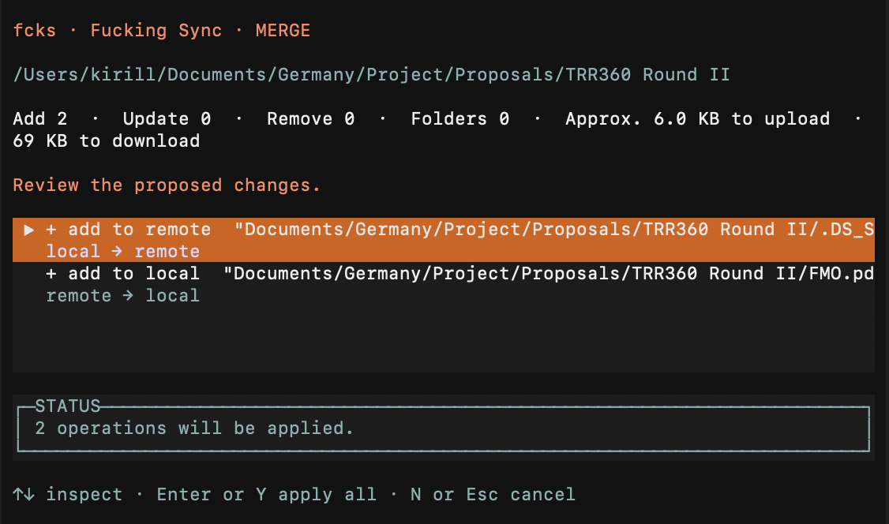

# fcks - F@cking Sync

An experimental, simple, no-frills command-line WebDAV sync client written in
plain JavaScript (Bun), with support for virtual folders.



## How it works

```
LOCAL ROOT                                  DAV ROOT
/my/files                                   /remote/files
    |                                             |
    +---- docs/report.pdf <== same path ==> docs/report.pdf
    +---- photos/cat.jpg   <== same path ==> photos/cat.jpg
    |                                             |
    +---------------- SCAN BOTH ------------------+

      fcks push     = remote should look like local
      fcks pull     = local should look like remote
      fcks merge    = keep both sides; most recently modified file wins
      fcks scaffold = copy remote folder structure, without files
      fcks free     = delete local files, but keep folders
      fcks rm       = delete a path locally and remotely
      fcks ls       = list both remote and local directories
      fcks find     = find a file / folder
```

Features:

- No temporary files, no database
- Stateless
- Limited set of commands
- Virtual folder scaffolding
- Folder-tree mirroring
- Search / browse features
- File downloads and uploads, plus local folder cleanup, including subfolders

This project was born out of deep frustration with OneDrive and Nextcloud sync
issues on macOS. Nevertheless, fcks supports all platforms.

### Why?

Other popular solutions didn’t provide the kind of virtual-folder support I
needed: a simple alternative to Files On-Demand. Instead of keeping placeholder
files, fcks keeps only the folder structure visible and lets you "hydrate" its
contents when needed.


## List of Commands

```sh
fcks                 # help and configured DAV endpoint
fcks --config        # local folder, DAV connection, and remote root
fcks --reset         # delete the complete fcks app-data directory
fcks .               # merge the current folder (same as `fcks merge .`)
fcks push [path]     # make the remote subtree match local
fcks pull [path]     # make the local subtree match remote
fcks merge [path]    # copy both ways; most recently modified file wins; never delete
fcks scaffold [path] # recreate the remote folder structure locally
fcks free [path]     # delete local files while retaining their folders
fcks rm <path>       # delete a file/folder locally and remotely
fcks ls [path]       # list shared, local-only, and remote-only entries
fcks find '*.pdf'    # recursively find matching local and remote entries
fcks find 'src/**/*.js' 'LICENSE' # multiple patterns are OR matches
fcks push -f .       # skip confirmation (`-f` works with every operation)
fcks pull -s .       # select one remote child folder to pull
fcks push -s .       # select one local child folder to push
```

Short aliases are available: `ph` for `push`, `pl` for `pull`, `sc` for
`scaffold`, and `fr` for `free`.

The path defaults to the current directory for commands with an optional path.
`rm` requires a path. `push`, `pull`, `merge`, `free`, and `rm` operate on an
exact file or folder target; `scaffold` and `ls` require a folder. Every target
must be the configured local root or a descendant; paths
outside it are rejected. Synchronization rejects symbolic links because
WebDAV cannot preserve their semantics safely. The relative path below
the configured local root is preserved below the configured DAV root. For
example, local root `/foo` and DAV root `/bar` map
`/foo/docs/file.txt` to `/bar/docs/file.txt`.

All mutating commands first display additions, changes, removals, and conflicts,
along with approximate totals to upload, download, or free locally or remotely,
then ask once for confirmation. `-f` auto-confirms; it goes before the optional
path, for example `fcks pull -f ./archive` or `fcks -f ./archive` for an
implicit merge.

`pull -s [path]` opens an interactive list of immediate remote child folders,
creates the selected folder locally, and pulls that subtree. `push -s [path]`
lists immediate local child folders and pushes the selected subtree. `-s` is
only available for `pull` and `push`, and cannot be combined with `-f`.

In an interactive terminal, regular sync commands use OpenTUI for the same
simple flow: scan, review the complete plan, confirm once, and watch progress.
`ls` uses an OpenTUI browser for its combined local and remote listing. Select a
folder that exists on either side and press `Enter` to open it; use `Left` or
`Backspace` to go to its parent. Press `P` to push, `L` to pull, or `M` to merge
any selected file or folder. If the selected item is missing on the source side,
the authoritative operation proposes deleting it from the destination side.
These actions retain the normal preview and confirmation step, then return to
the browser.
When terminal interaction is unavailable, it falls back to a plain-text table
that can be redirected or piped.

`find` searches recursively from the current directory and combines local and
remote results. Its patterns use conventional shell glob syntax: `*` matches
zero or more characters within one path segment, `?` matches one character,
`[abc]` matches a character set, and `**` crosses folders. A pattern without a
slash, such as `*.pdf` or `README.md`, is matched against every entry name. A
pattern with a slash, such as `reports/**/final-?.pdf`, is matched against the
relative path. Multiple pattern arguments are OR matches. Quote patterns so
the shell does not expand them before `fcks` receives them.

In an interactive terminal, `find` shows progress while scanning and matching,
then opens a selectable results table. Press `P`, `L`, or `M` to synchronize the
exact result, `Enter` or `O` to reveal a local result in Finder (or the platform
file manager), and `C` to start a subshell in the selected folder or a selected
file's parent. Exit that subshell to return to refreshed search results. A
remote-only result must be pulled before it can be opened locally. When output
is redirected or piped, `find` prints its result table instead.

Press `Esc` or `Ctrl+C` to interrupt planning or execution. No new work is
started, active hashes and transfers are aborted, and the result reports how
many operations had already completed. Those completed changes are kept; the
next `push`, `pull`, or `merge` reconciles any partial state. Downloads stream
directly into place without staging files, so interruption can leave a partial
destination file. Interrupted CLI runs exit with status 130.

- Plain-text `ls` lists one folder level. Its interactive browser can traverse
  folders and only changes data when you explicitly launch a selected-item
  push, pull, or merge and confirm the resulting sync plan.

- `push` and `pull` are intentionally authoritative and may delete files on the
destination side.

- `merge` never deletes; differing files are copied from the side with the later
modification time. Equal-time content conflicts and file-versus-directory
conflicts are reported and left unchanged.

- `scaffold` creates missing directories implied by remote files without
modifying existing local files or folders.

- `free` prints a merge-first safety warning. For a folder target, it removes
all files below it without removing directories; for a file target it removes
only that file.

- `rm` checks the exact path on both sides and removes whichever copies exist.
Remote directory deletion includes its complete subtree. A missing local copy
does not prevent the remote copy from being found and removed.

Hidden files and folders are included. Empty folders are ignored, like Git.

### .fcksignore
For `push` and `merge`, a `.fcksignore` file can exclude files and folders
below the directory that contains it. Its syntax follows Git ignore patterns:
blank lines and `#` comments are skipped, glob patterns are supported, a
trailing `/` matches folders, and `!` negates a previous pattern. Nested
`.fcksignore` files apply to their own subtrees. If the same ignore file exists
locally and remotely, the newer copy supplies the rules for that operation.
The `.fcksignore` files themselves are synced normally, and `free` removes them
along with all other local files.

### Hashes
The implementation keeps no sync database. It uses bounded-concurrency scans,
streaming hashes, direct streamed downloads, and streamed uploads, so memory
use does not scale with file size. WebDAV ETags are treated as opaque
validators. Equal-sized files at the same path are streamed through SHA-256 on
both sides for an accurate comparison.

### File attributes

Note that standard WebDAV does not carry portable
POSIX ownership, ACL, executable-bit, or extended-attribute metadata, so those
attributes are not synchronized between machines.

`fcks --reset` recursively removes the entire OS-specific `fcks` configuration
directory.

## Release binaries

Publishing a GitHub Release builds standalone `fcks` executables for x64 and
ARM64 versions of Linux, Windows, and macOS. These executables include Bun, so
users do not need a separate Bun installation.

To make the executable available system-wide, rename the binary to `fcks`
(`fcks.exe` on Windows) and move it to:

- Windows: `C:\Program Files\fcks\` and add this directory to the system `PATH`
- GNU/Linux: `/usr/local/bin/`
- macOS: `/usr/local/bin/`

On GNU/Linux and macOS, make the file executable:

```sh
chmod 755 /usr/local/bin/fcks
```

Note: *On macOS, you might need to approve the first run in the security
settings because the app is not signed.*

### I don't like installing shady software

If you already have Bun installed, you can run the project directly:

1. Clone this repository and `cd` into it.
2. Run these commands to temporarily add `fcks` to your `PATH`:

```sh
bun install
bun link
```

## Development

```sh
bun install
bun run src/cli.js --config
```

The compact configuration flow first asks for a local folder and then for DAV
credentials. It verifies the connection and lets you browse, create, and choose
a remote root. The configuration is written with owner-only permissions to the
native user configuration directory:

- macOS: `~/Library/Application Support/fcks/config.json`
- Linux: `$XDG_CONFIG_HOME/fcks/config.json` or `~/.config/fcks/config.json`
- Windows: `%APPDATA%\\fcks\\config.json`

__Warning__: FCKS stores the password in the "protected" JSON configuration file.

__Important__: All remote paths are relative to the configured DAV root.
Traversal with `..` (leading to the folder outside the configured root) is rejected.

Happy FCKSing, everyone!
